<p align="center"></p>

<h1 align="center">TIKAZ Visual Content for Codex</h1>
<p align="center"><strong>Provider-neutral illustration, concise writing, and lawful music workflows with publishing QA.</strong></p>
<p align="center"><a href="https://github.com/TIKAZI/TIKAZ-Codex-Visual-Content/actions/workflows/validate.yml"></a> <a href="LICENSE"></a> </p>
<p align="center"><a href="https://github.com/TIKAZI/TIKAZ-AI-Skills">← Explore all six TIKAZ AI Skills for Codex suites</a></p>

---

## One suite, ready to install

This repository is the independently installable **visual-content** distribution from [TIKAZ AI Skills for Codex](https://github.com/TIKAZI/TIKAZ-AI-Skills). The monorepo is the canonical development source; this repository is automatically synchronized and optimized for people who need only this workflow.

Designed, integrated, refactored, and continuously maintained by **TIKAZ**. This is a community-maintained project, not an OpenAI-official repository.

## What makes it different

- **One visual identity and one shot card own each asset**
- **Chinese labels, factual claims, alt text, and publishing-size legibility are verified**
- **Music discovery retains license and attribution evidence**

## Install

Clone or download this repository, then copy the repository folder into the Skill directory supported by your Codex environment. The root `SKILL.md` is the suite orchestrator; child folders are focused Skills that can also be installed separately.

```bash
git clone https://github.com/TIKAZI/TIKAZ-Codex-Visual-Content.git
```

## Try it

```text
Turn this essay into one original hand-drawn metaphor with a shot card, verified Chinese labels, and alt text.
```

```text
Explain this warehouse process as a sourced 16:9 logistics diagram with aligned nodes and explicit exceptions.
```

```text
Remove filler from this caption, then find lawful music and retain the download and attribution evidence.
```

## How the suite works

Read [SKILL.md](SKILL.md) for the owning workflow, [references/routing.md](references/routing.md) for specialist routing, and [references/output-contract.md](references/output-contract.md) for the verified handoff. Optional tools are detected at runtime; local login state or machine-specific software is never promised as universally available.

## Repository structure

```text
./
├─ SKILL.md                 # suite orchestrator
├─ agents/                  # Codex UI metadata
├─ references/              # routing and output contract
├─ <child-skill>/           # independently installable specialists
├─ DISTRIBUTION.yml         # canonical source and sync metadata
└─ scripts/                 # deterministic validation
```

## Canonical source and contributions

Development, source review, and cross-suite architecture live in [TIKAZ-AI-Skills](https://github.com/TIKAZI/TIKAZ-AI-Skills). This distribution synchronizes from `suites/visual-content` every week and can also be refreshed manually through GitHub Actions.

Source modes, observed licenses, and concrete TIKAZ contributions are recorded in [SOURCES.yml](SOURCES.yml) and [THIRD_PARTY_NOTICES.md](THIRD_PARTY_NOTICES.md). TIKAZ-authored files are released under the [MIT License](LICENSE).
